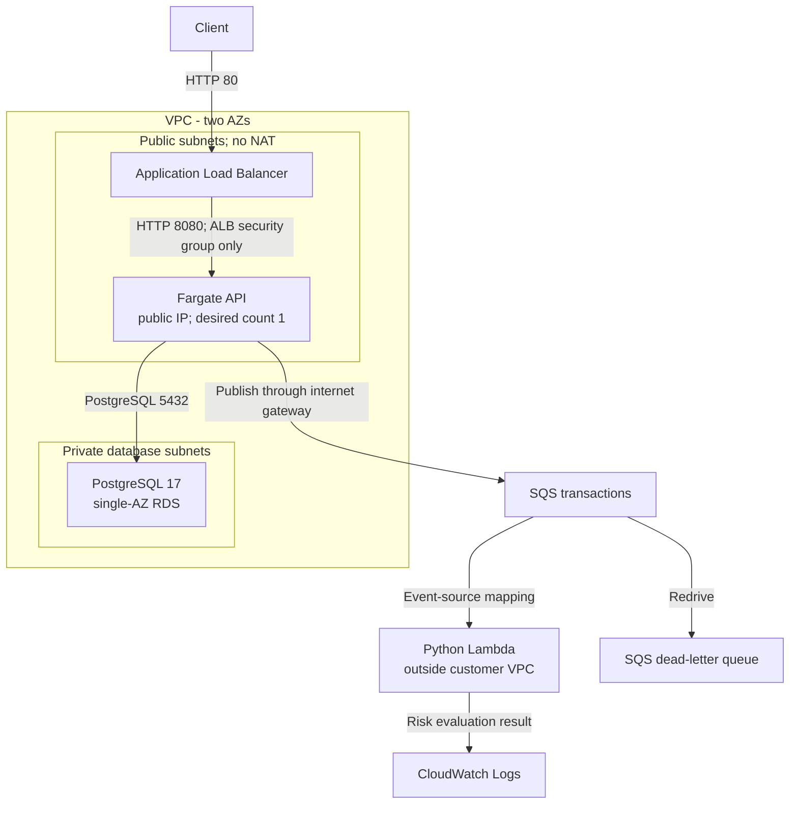

# FinGuard

**Cloud-Native Transaction Processing & Personal Finance Platform**

FinGuard processes transactions through a Java / Spring Boot REST API, stores them in PostgreSQL, publishes events to Amazon SQS, and evaluates risk asynchronously with a Python AWS Lambda worker. Terraform defines the cloud infrastructure.

The project demonstrates infrastructure automation, cost-conscious architecture decisions, and database integrity. It is now extending into a personal finance application: the Finance database foundation is committed, internal ledger Create/Read is implemented locally, and an Angular client and AI classification are planned.

**Portfolio snapshot:** the latest tagged milestone is `v0.8.5`. Finance development is separate and ongoing. Status was reviewed on **2026-10-20**; this page does not assert that an AWS deployment is currently running.

[Phase 8.0 architecture](docs/architecture/phase-8.0.md) | [Phase 8.5 architecture](docs/architecture/phase-8.5.md) | [Cost decision](docs/decisions/0001-cost-optimization.md) | [Historical smoke test](docs/verification/phase-8.5.md) | [Changelog](CHANGELOG.md)

## Architecture at a glance

Phase 8.5 configuration at [`v0.8.5`](https://github.com/maruko33/finguard/tree/v0.8.5):



The API writes a transaction, publishes its event, and returns the transaction response. Lambda evaluates the message and logs the risk result; it does not write scores back to PostgreSQL. There is no transactional outbox, so database persistence and SQS publication are not atomic.

The original [Phase 8.0 configuration](docs/architecture/phase-8.0.md) placed both API and polling worker in private application subnets behind two NAT Gateways. [Phase 8.5](docs/architecture/phase-8.5.md) moved the API into public subnets, restricted API ingress to the ALB security group, removed NAT, and replaced the continuously running worker with Lambda. This removes specific fixed-cost resources; **no measured billing savings are claimed**.

A two-AZ network does not make this a production HA deployment: the API has one desired task, RDS explicitly uses `multi_az = false`, and the ALB listener uses HTTP without a configured TLS listener. These are documented development tradeoffs.

**Historical E2E acceptance - 2026-10-10:** ECS 1/1, health HTTP 200, transaction POST HTTP 201, a matching transaction ID in the Lambda log with risk **80 / HIGH**, and zero reported queue counts. The [verification record](docs/verification/phase-8.5.md) preserves the recovered evidence and its limits; this is not a current deployment check.

## What is implemented

| Area | Status | Scope and evidence |
| --- | --- | --- |
| Transaction API | Implemented, `v0.8.5` | Spring Boot 4.1 / Java 21; create and retrieve transactions; validation and error handling. [Controller](services/transaction-api/src/main/java/com/finguard/transactionapi/transaction/controller/TransactionController.java). |
| Persistence | Implemented, `v0.8.5` | PostgreSQL 17, Spring Data JPA, Flyway migrations. [V1 schema](services/transaction-api/src/main/resources/db/migration/V1__create_transactions_table.sql). |
| Asynchronous risk evaluation | Implemented, `v0.8.5` | API publishes to SQS; Python Lambda evaluates deterministic amount rules and logs the result. [Handler](services/risk-worker/src/risk_worker/lambda_handler.py). |
| AWS infrastructure | Versioned Terraform configurations | Private ECS + NAT at `v0.8.0`; NAT-free ECS + Lambda at `v0.8.5`. [Terraform](infra/terraform). Historical deployment observations are documented separately. |
| Finance database foundation | Committed on the finance branch | Six tables, ownership/type constraints, Money value object, and PostgreSQL integration tests at [`ac11710`](https://github.com/maruko33/finguard/commit/ac11710467c2ee7459be13b6b18e0050df767295). |
| Full Finance CRUD | In Progress | Internal manual Create/Read is implemented and tested in the development worktree but is not yet in the published finance commit. Update, Soft Delete, and List are planned next. |
| Angular client | Planned | No Angular application is included in this snapshot. |
| Finance authentication and API exposure | Planned | Trusted internal user IDs are used for current service tests; an authenticated Finance API is not exposed. |
| AI classification | Planned | The existing risk evaluator is rules-based, not an AI/ML model. |

The Finance domain lives under `com.finguard.transactionapi.finance` in the existing Spring Boot service. Its [committed V2 migration](https://github.com/maruko33/finguard/blob/ac11710467c2ee7459be13b6b18e0050df767295/services/transaction-api/src/main/resources/db/migration/V2__create_finance_foundation.sql) adds `app_user`, `financial_account`, `category`, `import_batch`, `import_candidate`, and `ledger_entry`. Composite foreign keys enforce ownership/type consistency; transaction dates remain separate from optional occurrence timestamps. The existing transaction/risk model remains a separate domain.

## Learning Journey / Engineering Evolution

| Stage | Problem addressed | Engineering decision and lesson |
| --- | --- | --- |
| Transaction API, `v0.1.0` | Define a request lifecycle and predictable failures. | Separate controller, service, and repository responsibilities; test creation and missing-record behavior. |
| PostgreSQL, `v0.2.0` | Keep transaction data across process restarts. | Add JPA persistence and Flyway-managed schema changes; treat database structure as versioned code. |
| Docker and Compose, `v0.3.0`-`v0.4.0` | Coordinate application and database environments. | Package the Java runtime and orchestrate services; distinguish a built application artifact from runtime configuration. |
| Python and SQS, `v0.5.0`-`v0.6.0` | Run risk evaluation outside the request path. | Separate deterministic policy from message transport; recognize retries and the database/message delivery boundary. |
| Terraform and private ECS, `v0.7.0`-`v0.8.0` | Make cloud infrastructure repeatable and network boundaries explicit. | Define queues, IAM, subnet routing, security groups, containers, and a private database in Terraform. |
| NAT-free ECS and Lambda, `v0.8.5` | Reduce the fixed resource footprint of a development deployment. | Remove two NAT Gateways and an always-running worker; preserve restricted ingress and private RDS while documenting availability and cost tradeoffs. |
| Personal Finance, ongoing | Model owned accounts, categories, and exact ledger amounts. | Use a separate domain and database constraints, then build internal service slices before exposing authenticated workflows. |

The [changelog](CHANGELOG.md) ties these stages to actual commits and tags. `v0.4.0` is a local tag; its target commit is reachable on GitHub, but the tag was absent from the remote during the 2026-10-20 audit.

## Verification and evidence

| Record | What it establishes | Limit |
| --- | --- | --- |
| [2026-10-10 Phase 8.5 smoke test](docs/verification/phase-8.5.md) | Recovered terminal evidence links a 6000.00 CAD POST returning HTTP 201 to Lambda 80/HIGH through the same transaction ID; ECS/health and specific queue observations are also recorded. | Selected historical details are transcribed; the full original transcript and deployed image identity are not archived. No independent database-row assertion or current-state check is claimed. |
| [2026-10-17 finance foundation verification](https://github.com/maruko33/finguard/blob/ac11710467c2ee7459be13b6b18e0050df767295/services/transaction-api/docs/phase9/verification.md) | Records 11 Java tests passing, including five real PostgreSQL schema integration tests and a Money test. | Historical result for the finance commit, not a result for this documentation branch or a CI badge. |
| [Java tests](services/transaction-api/src/test/java/com/finguard/transactionapi) and [Python risk tests](services/risk-worker/tests/test_risk_engine.py) | Source for transaction behavior and low/medium/high risk-rule checks. | Test source alone does not prove that a particular environment or revision passed. |

No deployment, billing measurement, or application test was run as part of this documentation change. Automated CI is planned as a separate portfolio increment.

## Local development

Use Linux or WSL with **JDK 21**, **Python 3.12**, **Docker Engine and Docker Compose**, and access to the dependencies downloaded by the Maven wrapper. PostgreSQL 17 is provided by Compose. A separate Maven installation is not required.

**Validation status:** the commands below were statically checked against the Maven wrapper, Compose services, profile settings, and Dockerfile. They were not executed from a fresh checkout for this documentation review; no new Quick Start or application-test success is claimed.

### Database and Java tests

The wrapper targets `localhost:5432/finguard`; port 5432 must be available for the intended Compose database rather than occupied by a different development database. Use a development database compatible with the checked-out snapshot: Phase 8 has only V1, while the Finance database may already have V2. Pointing this Phase 8 snapshot at that Finance database can fail Flyway validation because V2 is absent from the local migration files. Keep the two snapshots in separate database environments and preserve the existing Finance volume; do not reset it to run these instructions.

From the repository root, create `.env` from [.env.example](.env.example) **only if it does not already exist**. Set `POSTGRES_PASSWORD` to a local development password; for an existing database volume, use its existing password. Do not source `.env` or print resolved Compose configuration containing credentials.

```bash
# Repository root, after configuring .env:
docker compose up -d postgres

cd services/transaction-api
AWS_REGION=ca-central-1 python3 scripts/mvn-local.py clean package
```

The [local wrapper](services/transaction-api/scripts/mvn-local.py) reads Compose configuration and supplies database settings to Maven. The AWS region allows the existing SQS client bean to initialize; these Java tests do not send SQS messages. Leave the example queue URL as a placeholder for tests, and unset conflicting `SPRING_DATASOURCE_*` or `SPRING_APPLICATION_JSON` overrides before using the wrapper.

This snapshot runs the Phase 8 transaction tests. On the [finance branch](https://github.com/maruko33/finguard/tree/feature/finance-recorder), the same command also runs the finance tests; those require real PostgreSQL and create/drop only their randomly named test schemas. Application startup can apply pending migrations to the configured development database, so use an appropriate development database and retain its data. Changing `.env` does not reset an existing volume.

### Python rule tests

From the repository root, use a separate local environment; a previously committed virtual environment is not a portable dependency installation:

```bash
python3 -m venv /tmp/finguard-risk-tests
/tmp/finguard-risk-tests/bin/python -m pip install -r services/risk-worker/requirements.txt
PYTHONPATH=services/risk-worker/src /tmp/finguard-risk-tests/bin/python -m pytest services/risk-worker/tests
```

These tests exercise the deterministic risk engine without calling AWS. The commands are setup instructions, not claimed results from this documentation change.

### AWS-connected runtime

Transaction creation publishes to SQS. A complete runtime requires an existing queue, a valid `SQS_QUEUE_URL` in `.env`, and an AWS profile with the appropriate permissions. No LocalStack or offline queue implementation is included.

For the existing Compose runtime, configure the `finguard-dev` profile with the intended region and credentials on the host. Compose mounts `~/.aws` read-only into the API and worker. Build the JAR with the Maven command above before building the API container: its [Dockerfile](services/transaction-api/Dockerfile) copies `target/*.jar` rather than compiling Java.

**Requires valid AWS credentials and an existing queue. This command can send real SQS messages and incur AWS charges.**

```bash
# Repository root; requires existing AWS configuration and queue:
docker compose up --build transaction-api risk-worker
```

This local Compose topology uses the polling Python worker. The cloud Phase 8.5 Terraform deployment uses Lambda instead. Running this runtime can send real AWS messages; the historical smoke-test record does not provision a new environment.

## Repository map

```text
services/transaction-api/       Spring Boot API, migrations, Java tests, Maven wrapper
services/risk-worker/           Python risk rules, SQS/Lambda entry points, tests
infra/terraform/               Versioned AWS infrastructure configuration

docs/architecture/             Phase 8.0 and 8.5 topology and limitations
docs/decisions/                Retrospective architecture decision record
docs/verification/             Historical observations and evidence provenance
CHANGELOG.md                   Tag-linked engineering milestones
```

Finance designs and committed foundation code are on `feature/finance-recorder`; this portfolio documentation does not move or modify that development work. Future product work includes authenticated Finance workflows, the remaining CRUD operations, an Angular client, and AI-assisted classification. Stable-main organization and CI are separate portfolio work.
