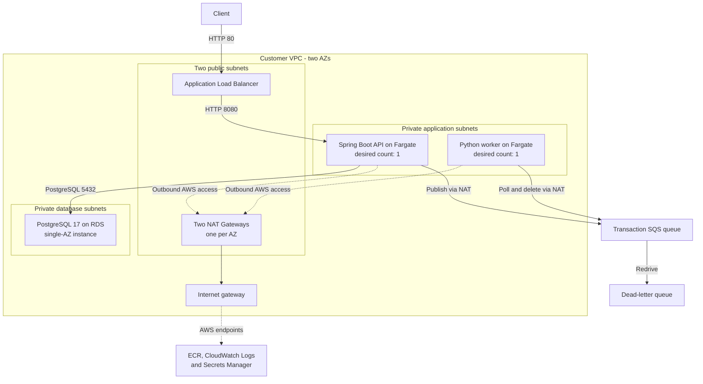
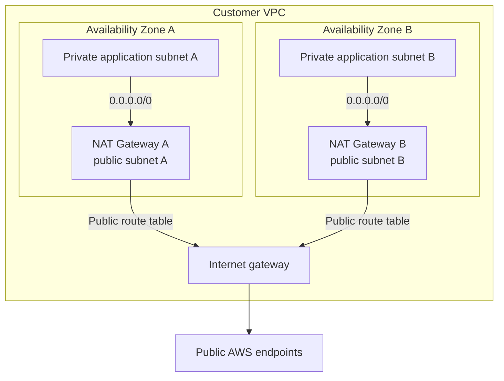

# Phase 8.0: Private ECS with NAT Gateways

This milestone moved FinGuard's transaction API and asynchronous risk worker into a Terraform-managed AWS network. It demonstrates how routing, security groups, task roles, managed credentials, and application dependencies fit together.

**Source baseline:** tag `v0.8.0`, commit [`d0ad398`](https://github.com/maruko33/finguard/commit/d0ad3987d4b7220dfb88522fd980e6e736cc977e). This document calls the original private ECS architecture **Phase 8.0** to match its Git tag; it was also described as Phase 8.1 in project discussions.

The diagram and settings below describe the committed configuration. They do not establish the current AWS deployment state. Historical deployment and HTTP success were reported by the project owner, but a corresponding raw test transcript has not been included in this documentation.

## Logical architecture

The API and worker each have one desired task across the eligible private subnets; the diagram does not place one task in every AZ. Solid application arrows show logical communication. Dotted arrows show outbound infrastructure access.

## Per-AZ outbound routing

Each private application route table references the NAT Gateway with the same Terraform index and AZ. The database subnets use a separate route table with no configured internet default route. These relationships are explicit in [`network.tf`](https://github.com/maruko33/finguard/blob/d0ad3987d4b7220dfb88522fd980e6e736cc977e/infra/terraform/network.tf).

## Request and processing flow

1. The public ALB forwards HTTP port 80 traffic to the API's IP target on port 8080. Its health check is configured for `/api/v1/health` with an expected status of `200`.
2. The API saves a transaction in PostgreSQL and publishes a transaction-created event to SQS.
3. The Python Fargate worker long-polls the queue, applies amount-based risk rules, logs the result, and deletes a successfully processed message.
4. On a worker exception, the consumer leaves the message undeleted. The queue's redrive policy provides a DLQ path after repeated receives.

The risk result is a deterministic rules-based score. This milestone does not implement AI classification or persist risk results back to the transaction record.

Sources: [ALB configuration](https://github.com/maruko33/finguard/blob/d0ad3987d4b7220dfb88522fd980e6e736cc977e/infra/terraform/alb.tf), [transaction service](https://github.com/maruko33/finguard/blob/d0ad3987d4b7220dfb88522fd980e6e736cc977e/services/transaction-api/src/main/java/com/finguard/transactionapi/transaction/service/TransactionService.java), [SQS consumer](https://github.com/maruko33/finguard/blob/d0ad3987d4b7220dfb88522fd980e6e736cc977e/services/risk-worker/src/risk_worker/sqs_consumer.py), [risk engine](https://github.com/maruko33/finguard/blob/d0ad3987d4b7220dfb88522fd980e6e736cc977e/services/risk-worker/src/risk_worker/risk_engine.py), and [queue definitions](https://github.com/maruko33/finguard/blob/d0ad3987d4b7220dfb88522fd980e6e736cc977e/infra/terraform/main.tf).

## Verified controls and operating settings

| Area | Configuration at `v0.8.0` |
| --- | --- |
| Task placement | API and worker use private application subnets with `assign_public_ip = false`. |
| Compute | API: 256 CPU units / 1,024 MiB; worker: 256 CPU units / 512 MiB; one desired task per service. |
| Network boundaries | ALB accepts port 80 from the internet; API accepts port 8080 only from the ALB security group; RDS accepts port 5432 only from the API security group. The worker has outbound rules and no inbound rules. |
| Database | PostgreSQL 17, `db.t4g.micro`, 20 GiB gp3, `publicly_accessible = false`, `multi_az = false`. |
| Credentials | RDS manages its master password; the ECS execution role can retrieve that secret and inject the password into the API container. |
| Runtime IAM | The API task role can send messages to the transaction queue. The worker task role can receive, delete, change visibility, and read attributes for that queue. |
| Logs | Separate API and worker CloudWatch log groups, each configured with seven-day retention. |

Sources: [ECS](https://github.com/maruko33/finguard/blob/d0ad3987d4b7220dfb88522fd980e6e736cc977e/infra/terraform/ecs.tf), [security groups](https://github.com/maruko33/finguard/blob/d0ad3987d4b7220dfb88522fd980e6e736cc977e/infra/terraform/security.tf), [RDS](https://github.com/maruko33/finguard/blob/d0ad3987d4b7220dfb88522fd980e6e736cc977e/infra/terraform/rds.tf), and [IAM](https://github.com/maruko33/finguard/blob/d0ad3987d4b7220dfb88522fd980e6e736cc977e/infra/terraform/iam.tf).

## Tradeoffs and limits

- **Network redundancy and application availability are separate decisions.** The network spans two AZs, but each service has one desired task and RDS is single-AZ. This configuration does not demonstrate production-grade high availability.
- **Private task placement adds outbound infrastructure.** Two NAT Gateways support outbound access while tasks have no public IPs. They also add resources to operate and pay for; this document does not quantify cost.
- **HTTP is the configured transport.** No HTTPS listener or certificate is defined in the tagged ALB configuration.
- **Database persistence and event publication are separate operations.** There is no transactional outbox or implemented end-to-end deduplication contract. A database write can succeed before publication fails, so atomic delivery and exactly-once processing are not claimed.
- **Database settings are for a development milestone.** RDS uses managed master credentials for the application and `skip_final_snapshot = true`; a restricted application database role and recovery policy need separate design.

The engineering lesson from this phase was to trace a request beyond the application container: ingress depends on ALB and security-group rules, outbound AWS calls depend on routing and IAM, and database availability is a separate choice from subnet layout.

[Phase 8.5](phase-8.5.md) shows how the next milestone reduced continuously provisioned components while keeping the API, database, and asynchronous processing flow. The reasoning is recorded in [ADR 0001](../decisions/0001-cost-optimization.md).
