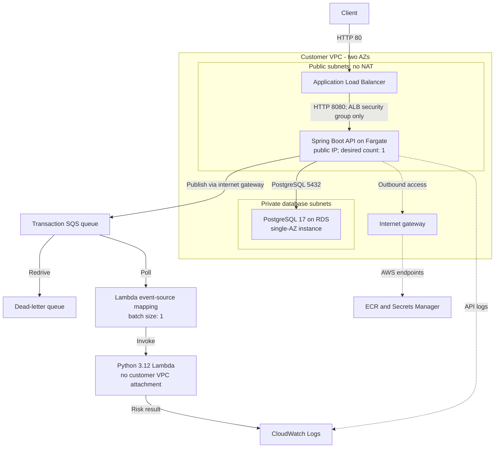

# Phase 8.5: NAT-free ECS with an SQS-triggered Lambda

Phase 8.5 changed the deployment model for a small development workload: the transaction API moved to public subnets, and the continuously running Python Fargate worker became an SQS-triggered Lambda. PostgreSQL remained in private database subnets.

**Source baseline:** tag `v0.8.5`, commit [`ebc5e41`](https://github.com/maruko33/finguard/commit/ebc5e41794b0992e7e160acaf114381e02f5d06e). The architecture is verified against the tagged source. The [historical verification record](../verification/phase-8.5.md) separately describes owner-confirmed observations from **2026-10-10**; neither that record nor this diagram reports today's deployment state.

## Logical architecture

The public subnet group is an eligible placement set for one desired API task, not one task per subnet. Application arrows show logical flow; the API's regional AWS traffic uses the internet gateway. Lambda has no `vpc_config` and no RDS connection in this milestone. A public IP supplies the API task's outbound path; inbound API traffic remains restricted to the ALB security group.

Sources: [network](https://github.com/maruko33/finguard/blob/ebc5e41794b0992e7e160acaf114381e02f5d06e/infra/terraform/network.tf), [ECS](https://github.com/maruko33/finguard/blob/ebc5e41794b0992e7e160acaf114381e02f5d06e/infra/terraform/ecs.tf), [security groups](https://github.com/maruko33/finguard/blob/ebc5e41794b0992e7e160acaf114381e02f5d06e/infra/terraform/security.tf), and [Lambda](https://github.com/maruko33/finguard/blob/ebc5e41794b0992e7e160acaf114381e02f5d06e/infra/terraform/lambda.tf).

## What changed from Phase 8.0

| Component | Phase 8.0 | Phase 8.5 |
| --- | --- | --- |
| API placement | Private application subnets; no public IP | Public subnets; public IP assigned |
| API outbound route | Per-AZ NAT Gateway | Internet gateway |
| NAT Gateways | Two | None defined |
| Private application subnets | Two | Removed from the network resource definitions |
| Python risk execution | Fargate service with one desired task | SQS-triggered Lambda |
| API and database | Fargate API; private PostgreSQL 17 | Same core application and database arrangement |
| Availability | One desired API task; single-AZ RDS | Same |
| HTTP entry point | Public ALB | Same |

The source still retains a worker security group, worker ECR repository, and private-application-subnet input variable. Those definitions do not imply an active Fargate worker or private application subnet resources at this tag. See [`security.tf`](https://github.com/maruko33/finguard/blob/ebc5e41794b0992e7e160acaf114381e02f5d06e/infra/terraform/security.tf), [`ecr.tf`](https://github.com/maruko33/finguard/blob/ebc5e41794b0992e7e160acaf114381e02f5d06e/infra/terraform/ecr.tf), and [`variables.tf`](https://github.com/maruko33/finguard/blob/ebc5e41794b0992e7e160acaf114381e02f5d06e/infra/terraform/variables.tf).

Removing two NAT Gateways and the continuously running worker provides a concrete cost-optimization rationale. No billing comparison or measured savings are claimed. [ADR 0001](../decisions/0001-cost-optimization.md) explains the tradeoffs.

## Request and processing flow

1. The public ALB forwards requests from HTTP port 80 to the Fargate API on port 8080. The target group's health check is `/api/v1/health`, expecting `200`.
2. `POST /transactions` saves the transaction in PostgreSQL, publishes an event to SQS, and returns HTTP `201` when the service call succeeds. `GET /transactions/{id}` retrieves the stored transaction.
3. The enabled Lambda event-source mapping polls the transaction queue with a batch size of one.
4. The Python handler parses the event, calls the existing risk engine, and logs the evaluation result to CloudWatch.
5. The queue has a redrive policy targeting the DLQ. The default visibility timeout is 60 seconds and the default maximum receive count is three; these are configurable inputs.

The amount rules return `80 / HIGH` for amounts at least `5000`, `50 / MEDIUM` for amounts at least `1000`, and `10 / LOW` otherwise. This is deterministic rules-based evaluation, with no model inference or currency-conversion step. The handler logs results without persisting them or changing transaction status.

Sources: [ALB](https://github.com/maruko33/finguard/blob/ebc5e41794b0992e7e160acaf114381e02f5d06e/infra/terraform/alb.tf), [controller](https://github.com/maruko33/finguard/blob/ebc5e41794b0992e7e160acaf114381e02f5d06e/services/transaction-api/src/main/java/com/finguard/transactionapi/transaction/controller/TransactionController.java), [service](https://github.com/maruko33/finguard/blob/ebc5e41794b0992e7e160acaf114381e02f5d06e/services/transaction-api/src/main/java/com/finguard/transactionapi/transaction/service/TransactionService.java), [handler](https://github.com/maruko33/finguard/blob/ebc5e41794b0992e7e160acaf114381e02f5d06e/services/risk-worker/src/risk_worker/lambda_handler.py), [risk engine](https://github.com/maruko33/finguard/blob/ebc5e41794b0992e7e160acaf114381e02f5d06e/services/risk-worker/src/risk_worker/risk_engine.py), [queue definitions](https://github.com/maruko33/finguard/blob/ebc5e41794b0992e7e160acaf114381e02f5d06e/infra/terraform/main.tf), and [defaults](https://github.com/maruko33/finguard/blob/ebc5e41794b0992e7e160acaf114381e02f5d06e/infra/terraform/variables.tf).

## Security and operating boundaries

- **Database:** private PostgreSQL 17, `multi_az = false`; its security group accepts port 5432 from the API security group. The subnet group spans two AZs, but there is one database instance with no Multi-AZ standby.
- **Credentials:** RDS manages the master password. The ECS execution role reads the managed secret and injects the password into the API container. A restricted application database role is not configured.
- **API IAM:** the task role can send messages to the designated transaction queue.
- **Lambda IAM:** the execution role can receive/delete messages and read attributes for that queue, plus write CloudWatch logs through the attached basic execution policy.
- **Runtime:** the API has one desired task with 256 CPU units and 1,024 MiB. Lambda uses Python 3.12, 128 MiB, and a 10-second timeout.
- **Transport and ingress:** the ALB listener is HTTP only. A public API task IP does not bypass the security-group rule that restricts port 8080 to the ALB.
- **Packaging:** Terraform's `archive_file` builds the Lambda package from `services/risk-worker/src`. The container image tag remains a configurable input; the source default alone does not prove which image digest was deployed during the smoke test.

Sources: [RDS](https://github.com/maruko33/finguard/blob/ebc5e41794b0992e7e160acaf114381e02f5d06e/infra/terraform/rds.tf), [IAM](https://github.com/maruko33/finguard/blob/ebc5e41794b0992e7e160acaf114381e02f5d06e/infra/terraform/iam.tf), [ECS](https://github.com/maruko33/finguard/blob/ebc5e41794b0992e7e160acaf114381e02f5d06e/infra/terraform/ecs.tf), and [Lambda](https://github.com/maruko33/finguard/blob/ebc5e41794b0992e7e160acaf114381e02f5d06e/infra/terraform/lambda.tf).

## Historical verification and limits

The project owner confirmed that test output observed on **2026-10-10** showed ECS tasks running `1/1`, ALB health HTTP `200`, transaction POST HTTP `201`, Lambda risk `80 / HIGH`, and zero SQS/DLQ messages. The [verification record](../verification/phase-8.5.md) preserves the provenance and limits of those observations. It does not substitute screenshots, synthetic CloudWatch output, or reconstructed AWS command output for the original evidence.

This milestone demonstrates a working path reported from that test session. It does not establish sustained availability, load capacity, complete retry behavior, or a current live deployment. Zero observed queue depth is a point-in-time observation, not an exactly-once delivery guarantee.

Database writes and SQS publication remain separate operations, with no transactional outbox. The risk handler has no implemented deduplication or persisted processing status. The configuration also retains one desired API task, single-AZ RDS, HTTP ingress, and development database deletion settings.

The engineering lesson was to match compute and networking choices to the workload while making their consequences explicit: public task placement changes outbound routing and makes security-group boundaries especially important; event-triggered execution removes the dedicated polling service while retaining the same risk rules.

[Previous architecture: Phase 8.0](phase-8.0.md) · [Decision: cost optimization](../decisions/0001-cost-optimization.md) · [Historical verification](../verification/phase-8.5.md)
